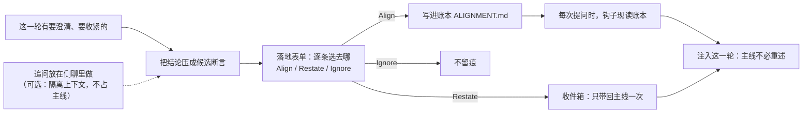

<p align="center">
  
</p>

# rein

一个 Codex 插件：把「对齐过的结论」从对话历史里抽出来，变成一份**每轮生效、可版本化**的项目状态；
让主线更干净，让侧聊更好用。

跟 Agent 对过的那些前提——定义、边界、做法——落成一本**对齐账本**（`ALIGNMENT.md`），
再由钩子在**每次提问**时现读、注入这一轮。于是结论不再随上下文压缩蒸发，也不用你反复重申。

追问和质疑可以放到隔离的上下文里做（Codex 的**侧聊**）：侧聊里谈成的结论能落回账本、也能一次性带回主线——侧聊变得好用。

**不只在侧聊**：主线的 Agent 一样会调 rein（给候选、开表单、开账本）。侧聊只是「过程隔离」的
一种手段、一个入口——这个插件要解决的是**对齐这件事本身**，不是侧聊。

## 问题

跟 Agent 协作时，「对齐」（这个前提对吗、这个说法我不接受、我们统一下这个词）几乎都发生在
**主线程**里。看起来自然，代价有四层：

- **跑题**：一次追问就把话题拉走；
- **上下文污染**：追问的来回全留在主线，真正要干的事被挤到后面；
- **结论会蒸发**：就算澄清了，结论也只是对话历史里的一段——**上下文一压缩就没了**，
  下一轮它又按旧前提继续；
- **重复付费**：同一个前提，往往要在好几轮里反复重申。

本质上是一件事：**「澄清过的结论」和「对话历史」性质不同，却被放在同一个容器里**。
历史是过程，结论是状态；状态混在过程里，就必然被过程冲掉。

现有手段都不够：写进 `AGENTS.md` 是「新会话才生效」；靠模型自觉记住是「不保险」；
每条都塞进项目文档，又会把文档变成草稿纸。

## 思路

三条：

1. **结论必须落成文件**——一本项目级、人可读、可 diff 的账本（`ALIGNMENT.md`）。
   「每轮都生效」只能靠文件，不能靠会话记忆：结论是状态、对话是过程，状态混在过程里就必然被冲掉。
2. **每轮现渲染、每轮注入**——不缓存、不派生：钩子在你**按下回车那一刻**读账本，
   渲染成一小段前提注入这一轮。所以侧聊刚落的、面板刚改的、手改的，下一轮一定带上。
3. **追问可以放到隔离上下文里做**——用Codex 原生的**侧聊**：质疑、收紧那几句不必都堆在主线，
   过程不弄脏主线，也省下一截上下文。而侧聊的产出能落回账本、也能一次性带回主线。
   **这是让侧聊好用的手段，不是产品的边界**——落地在主线里一样发生。

一句话：**把「对齐」从对话里抽出来，变成一份有版本、可回滚、每轮可见的项目状态。**



## 优势

- **结论不会蒸发，也不用反复重申**：它是一份文件，不靠模型的记性——压缩、换会话、开侧聊，
下一轮照样带上；说过一次就长在那儿。
- **主线不被打断**：追问可以放到侧聊里做，话题不再被拉走，上下文也不被追问的来回挤满；
而侧聊里的结论能落回账本、也能一次性带回主线——侧聊因此不只是「另一个窗口」。
- **结论有出处**：落地时留一份原文（你当时那句话），面板里点「原文」就能回看它当初是因为什么
才落的——账本太长、想退休某条时不用猜。
- **改是有痕迹的**：取代、退休都留档，条目一条不删——「我们曾以为是 X、后来改成 Y」这段
  本身就是价值，能查、能回滚。
- **就是一份普通 Markdown**：人可读、可 grep、可 diff；想在 PR 里 review，就在项目里放一本，
  跟着仓库走。
- **不弄脏工作区**：默认账本不进你的项目（`~/.codex/rein`）；即使你把账本放进了项目，
  收件箱与原文也留在数据目录，`git status` 不会多出别的东西。
- **去哪由你定，代价还可控**：每条候选你自己选 Align / Restate / Ignore，模型只给建议；
  每轮注入的是有上限的一小段，超了会明说。

## 安装

这个仓库本身就是一个 marketplace：

```sh
codex plugin marketplace add <owner/repo> # 本地路径: path/to/rein
codex plugin add rein@rein
```

装完**两步别省**，少一步就像“插件没生效”：

1. **重启 Codex app**——钩子与 MCP server 都是启动时加载的。
2. **设置 → Hooks 里把 rein 的钩子过一遍信任**——没信任的钩子Codex **静默不跑**，不报错、也没提示。

更新：`codex plugin marketplace upgrade` → `codex plugin add rein@rein` → 同样**重启 + 重新信任**。

装完如果账本面板（或 `/rein-ledger`）提示「钩子好像没在运行」，多半就是第 2 步没做——它正是替你看这个的。

需要 Codex——**桌面版或 CLI 都行**（面板只有桌面版有，见下面「Codex CLI」）。
**不用自己装 node**——插件会先找系统里的（Homebrew / nvm / Volta / …），都找不到才退回 app 自带的那份。

## 使用

### Codex Desktop

两个技能，都在输入框的 `/` 菜单里（「技能」分组）：

- **`rein`**——把结论落进账本。对话里你说定一条前提（“就这么办”,“记下来”等意思的表述），它会**问一句要不要记**，
  你同意就弹表单；也可以直接用 `/` 选它，或说“直接弹表单”“把这几条落一下”。
- **`rein-ledger`**——看和改已经落下的条目。

一次典型流程：

1. （可选）要追问一条回答，用Codex 的**侧聊**（选中那段文字，或输入框发 `/side`）：隔离上下文，
   不占主线。直接在主线里说也一样。
2. 让 Agent 调出**落地表单**——侧聊里、主线里都能调。表单**一问一页**，每条候选选一个去向：
   - **Align**：写进账本，以后每轮带上；
   - **Restate**：只带回主线说一次（命令式的要求、一次性的话）；
   - **Ignore**：不留痕。

   默认停在模型给的建议上，不改就是同意；整张表单都不想决定就按 **skip**。
3. 落地之后主 Agent 只说结果——「已落地 C-019」或「已复述，只带一次」。

结论过时了用**取代**（新的落上、旧的留痕不删），不再成立用**退休**。

### Codex CLI

桌面版和 CLI 共用同一份配置（`~/.codex/config.toml`）和同一套 `codex plugin` 命令——上面那两条
装一次，两边都认。装完在项目目录里敲 `codex` 进交互模式，用法跟桌面版一样：说一句「记下来」，
它就把结论整理成表单。

CLI 里各部分的可用情况（按 CLI 自己的特性表）：

- ✅ 技能（`rein`）、每轮注入的钩子、**落地表单**（CLI 支持 elicitation）；
- ❌ **账本面板**——它是 MCP App，CLI 里这个特性还没开（`/rein-ledger` 那边没有东西可开）。

钩子的信任记在 `~/.codex/config.toml` 的 `hooks.state.*` 里——桌面版过一遍，CLI 读的是同一份；
CLI 不用重启，每次都是新进程。

所以 CLI 里**落地没问题、看账本没有界面**：想看账本，让它念——「看看对齐了什么」会调
`rein_list` 把条目列出来；要改条目、要用「直接写一条」，回桌面版开面板。

`codex exec` 是非交互的，没有界面填那张表单——落地这套在那边用不了。

## 账本
### 位置

默认**不进你的项目**，落在插件的数据目录 `~/.codex/rein/projects/<项目哈希>/`，按项目分开，
A 项目读不到 B 项目的账。

想让账本跟着仓库走、能 diff / 进 PR？在项目里放一个 `ALIGNMENT.md`（内容随意），这个项目
就改用项目里那本。

**收件箱与原文不走账本那条路**：它们永远留在数据目录里（`~/.codex/rein/projects/<项目哈希>/`），
不进项目、不进 git——前者是「侧聊→主线」的一次性投递，后者是本地回溯用的旁证。

### 面板

`/rein-ledger`（或让 Agent 调 `rein_open_ledger`）在侧边打开面板：改标签、改措辞（走取代）、
退休、全部退休、归档失效。另有一个**「直接写一条」**——十拿九稳、不想走表单时的快车道
（跳过表单；写进去就是每轮带上，所以只适合长期前提）。

条目上还有一个**「原文」**：这条结论落地时留下的**你确认的那句话**，外加**被纠正对象的一句引用**
（有就带），取代过的还会附上「原结论」——也就是改之前那句。账本太长、想退休某条又拿不准时，
先点开看一眼。取代会带着原文走，退休则一起退休；「直接写一条」写的会注明是用户本人写的；
手写进账本的条目没有原文，点开会说明它是「外部写入」。原文**只给用户看**——它不进账本、
也不占模型的上下文。

落地原则上只走表单；「直接写一条」**只在这个面板上有**——模型的工具面上没有它，绕不过去。

## 类型（可选，纯标签）

类型是开放集合；增删只改项目里的 `.rein/config.toml`，不改代码、不用重装：

```toml
hot_block_max_items = 20

[types.foo]
label = "新花样"
```
